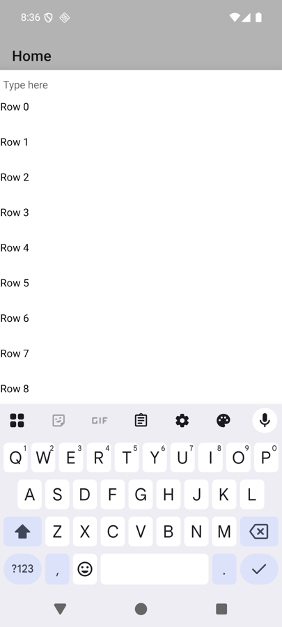
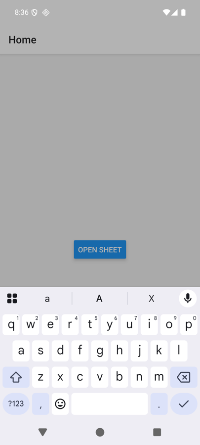

# rns-formsheet-keyboard-repro

Minimal reproduction for [software-mansion/react-native-screens#5126](https://github.com/software-mansion/react-native-screens/issues/5126):
on Android, a `fitToContents` form sheet stays partly under the keyboard after its content shrinks.

- react-native-screens 4.30.0 (exact), React Native 0.88.1, Expo SDK 58, New Architecture
- All the code is in [`App.tsx`](App.tsx)

## Run

```bash
npm install
npx expo run:android
```

## Steps

1. Tap **Open sheet**. The sheet holds a text input and 12 rows, taller than the space left above the keyboard.
2. Tap the input. The keyboard opens and the sheet lifts only by its spare space, so the lower rows stay under the keyboard (expected).
3. Type one character. The list shrinks to 2 rows.

**Expected:** the shorter sheet rests right above the keyboard.

**Actual:** the sheet keeps the keyboard offset computed for the tall content. In this project the whole shrunken sheet, including the focused input, ends up behind the keyboard (Android 16 emulator, Gboard).

| Keyboard open, 12 rows | After typing one character |
| --- | --- |
|  |  |
